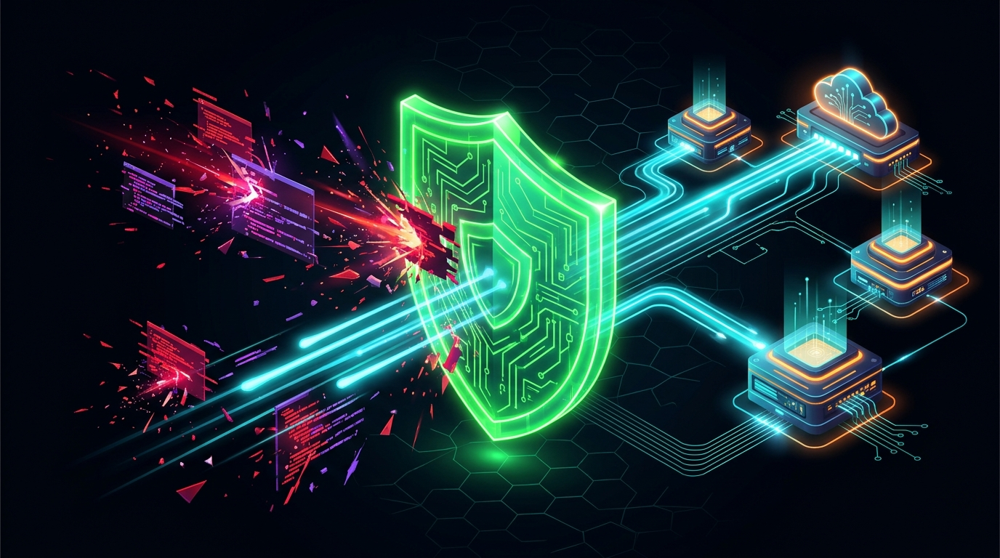
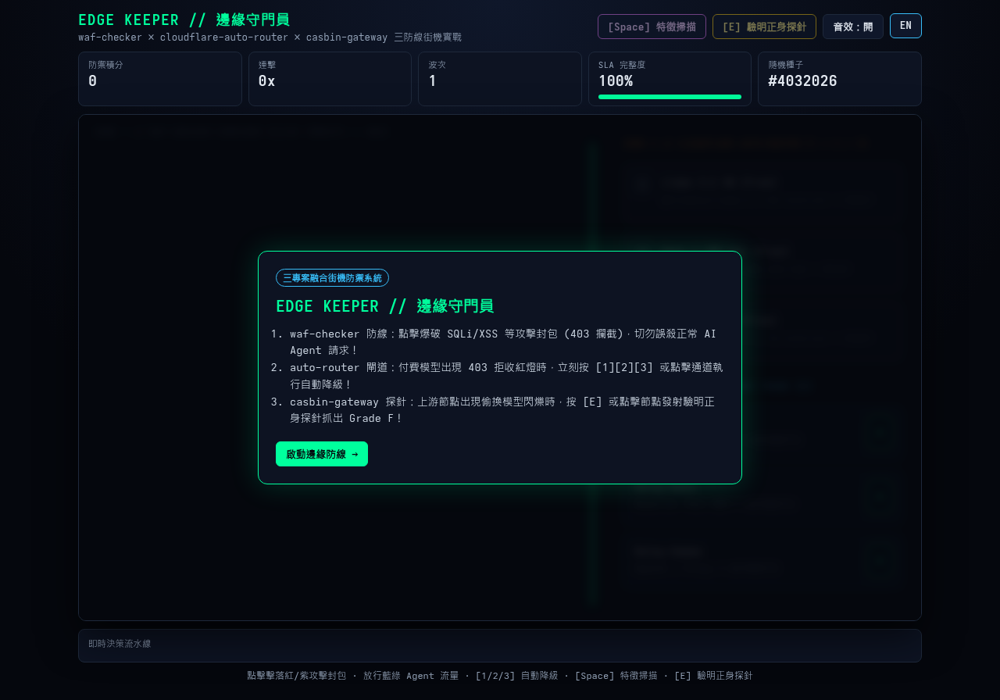
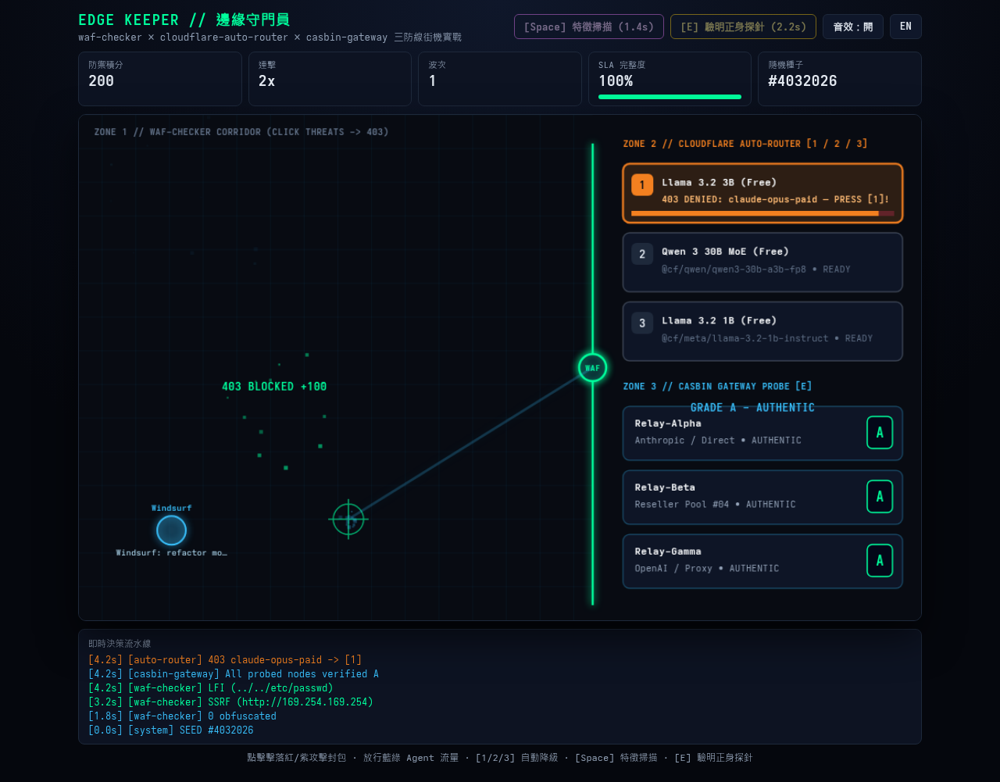
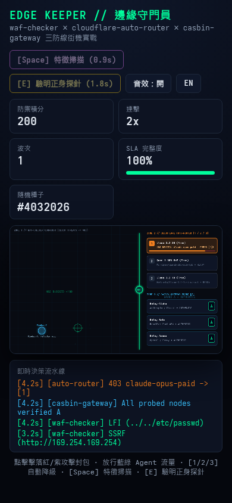

# EDGE KEEPER // 邊緣守門員：403 攻防戰

<p align="center">
  
</p>

<p align="center">
  <a href="https://edge-keeper.tw365ai.workers.dev">
    
  </a>
  <a href="https://github.com/tonnychiulab/edge-keeper/actions/workflows/deploy.yml">
    
  </a>
  <a href="docs/e2e-browser-report.md">
    
  </a>
</p>

> 把日常維運最常碰到的三種鳥事——**WAF 擋攻擊怕誤殺**、**AI Gateway 踩中付費模型 403**、還有**上游供應商偷換廉價模型**——做成一個純前端、打開就能玩的快節奏街機小遊戲。

---

## 🎮 三道防線怎麼玩？

遊戲把三個工具專案的真實情境接在同一條流水線上：

| 防線 | 靈感來源 | 操作方式 | 遊戲內機制 |
| --- | --- | --- | --- |
| **1. WAF 攔截走廊** | `waf-checker` | **滑鼠點擊／觸控**擊落紅紫攻擊封包<br>**`[Space]`** 特徵掃描 | 擋下 SQLi / XSS / SSRF / LFI 拿 `403 BLOCKED` 加分；讓藍綠色正常 Agent 請求安全通過；誤點正常流量會扣 SLA（**誤殺**）；`[Space]` 可掃出雙重編碼變形怪。 |
| **2. AI 閘道分流** | `cloudflare-auto-router` | **`[1]` `[2]` `[3]`** 或直接點擊右側通道 | 免費帳號呼叫 `cloudflare/auto` 時若誤選付費模型會跳 `403` 倒數紅燈，即時切換至免費模型完成**自動降級**即可拿分回血。 |
| **3. 上游探針抓鬼** | `casbin-gateway` | **`[E]`** 或點擊右下閃爍上游節點 | 當 `Relay-Alpha / Beta / Gamma` 出現偷換廉價模型或偽造快取等異常徵兆，發射**驗明正身探針**抓出 **Grade F** 假冒節點，可觸發全場清屏＋4.5 秒**零信任超頻**。 |

- **瀏覽器細節**：內建 SVG Data URI Favicon（隨 SLA 危急程度切換綠盾 / 紅警圖示），分頁 `<title>` 亦會與分數、SLA 狀態以及繁中／英文雙語切換即時連動。
- **同盤面挑戰**：網址列支援 `#seed=<數字>` 確定性隨機種子，方便分享同一盤面給朋友挑戰。

---

## 📸 實機畫面 (Screenshots)

### 1. 開局防線導引與 HUD


### 2. 三防線實戰畫面（403 雷射攔截 ＋ 閘道降級倒數 ＋ 上游評級）


### 3. 行動裝置窄螢幕排版 (`390×844`)


---

## 🧪 無頭瀏覽器實機驗收報告

每次改版皆透過 `playwright-core` 驅動真實無頭 Chromium 對 `vite preview` 建置產物執行端到端實測，確認無 `console.error` / `pageerror`、雙語 `<title>` 與 SVG Favicon 同步、實機點擊記分與行動端零水平溢位。

👉 查看完整實測數據與截圖紀錄：[docs/e2e-browser-report.md](docs/e2e-browser-report.md)

---

## 🚀 本地遊玩與驗證

```bash
# 安裝套件
npm install

# 啟動本地開發伺服器
npm run dev

# 執行型別檢查、單元測試、正式打包與無頭瀏覽器 E2E 驗收
npm run typecheck
npm test
npm run build
npm run test:e2e
```

---

## ☁️ 全自動 CI/CD 部署至 Cloudflare Workers

專案已配置 [`wrangler.jsonc`](wrangler.jsonc)（Cloudflare Workers Static Assets 靜態託管 `dist/`）與 [`.github/workflows/deploy.yml`](.github/workflows/deploy.yml)：

1. 任何 `push` 至 `main` 分支皆會自動執行 `typecheck` → `vitest` → `build` → `Headless Chromium E2E` → `wrangler deploy`。
2. 懶人一次性綁定（只需執行一次即可把 Cloudflare Account ID 與 API Token 寫入 GitHub Secrets/Vars 並觸發首次部署）：

```bash
npm run wizard
```

---

## 👥 共同製作

- **Tonny Chiu** ([@tonnychiulab](https://github.com/tonnychiulab))
- **Antigravity CLI**
